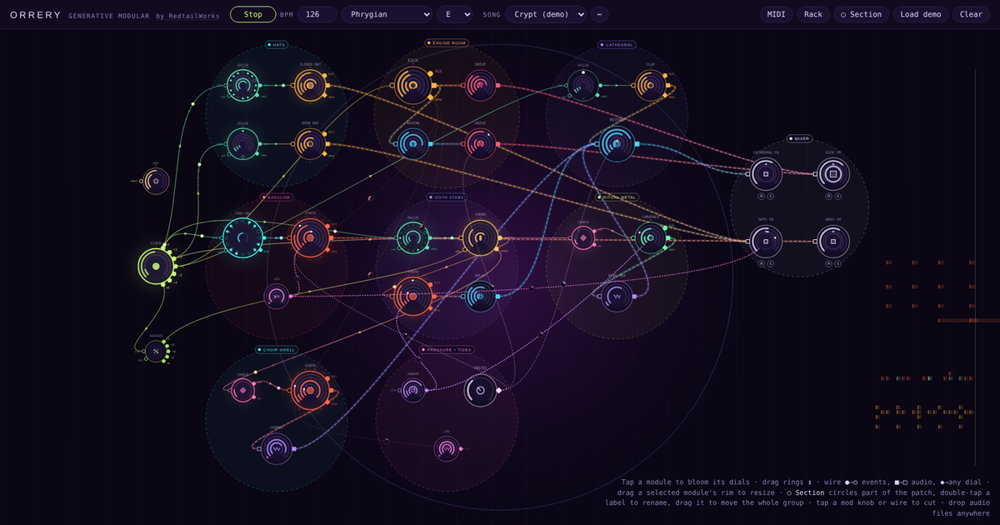

# Orrery

**Play it: <https://rustypawz.github.io/orrery/>**

Orrery is a generative modular music studio that runs in your browser. You drop modules onto a canvas, wire them together, and the patch plays itself: clocks fire pulses, sequencers and chord modules pick notes, synths, drums and samplers sound them, and modulation keeps reshaping everything over time. Every event travels visibly down its wire, so you can watch why each note happened.

It's a companion to the [RedtailWorks FM-1 firmwares](https://rustypawz.github.io/fm1-HYP1/). A [RedtailWorks](https://www.redtail.works) project.

## What's in the rack

- **Time:** Clock with ×4 ×3 ×2 ×1 ÷2 ÷4 ÷8 outputs and swing, free-running Pulsar, clock Divider, and Clock Mult (×2 ×3 ×4 ×8 of whatever pulse you feed it).
- **Sequence:** Ring Seq (1–32 steps, forward, reverse, pendulum or random, rotate, step chance, gate length), a Euclidean rhythm generator, Turing (a looping random shift register you can lock or let mutate), Marbles (notes rolled from a bell curve, with déjà vu to replay them) and Grids (an XY map morphing between house, breakbeat, half-time and electro drum patterns, with kick, snare and hat densities).
- **Harmony:** Key (scale and root for the whole patch, with key walks), Chord (9 chord types, inversions, strum, 7 progressions, arpeggio modes), Snap (bends any note onto chord tones: triad, seventh, sus, fifths, root or five-note, built on a chord root that can follow a progression), Shift.
- **Logic:** Chance, Walker, Repeater, Switcher (wire its output to several modules; only one of those ghost wires is live, and each step pulse moves events to the next, forward, reverse, pendulum or random), Gate (gives notes a length), Burst (turns one hit into a roll that speeds up or slows down), Groove (swing and humanized timing and velocity) and Logic (AND, OR, XOR and flip-flop for events).
- **Generate:** modules that play by themselves. Rain scatters random notes at a density you set, Orbits sounds each planet as it passes the top of its orbit, and Growth grows a vine one step per pulse, playing each tip's height and starting over each season.
- **Voices:** a fully shapeable synth (wave, detune, FM, filter and its envelope, attack, hold, release, pitch sweep, up to 7 unison oscillators) with Pluck, Bell, Bass, Pad, Lead, Zap and Supersaw presets, plus:
  - **Drone:** never retriggers. It sounds endlessly, or stays open for as long as notes keep arriving. Notes glide it to a new pitch, and its degree dial moves in whole steps of the key, so any modulation on it walks the drone through the scale.
  - **Acid:** a mono bass line voice. Notes that overlap slide into each other, and loud notes are accented.
  - **String:** a plucked string (Karplus-Strong).
  - **Cloud:** a granular voice that plays clouds of grains from any sample you drop on it, pitched to the key.
- **Drums:** three synthesized packs: Bloom 808, Chitin (alien percussion) and Dust (lofi).
- **Samples:** drop any audio file to make a sampler that plays it as a one-shot, a pitched instrument across your scale, a tempo-locked loop, or a slicer.
- **FX:** Delay, Reverb, Chorus, Flanger, Phaser, Tremolo, Ring Mod, Auto-Pan, Drive, Crusher, Filter, EQ, Compressor, Tape (wow, flutter, saturation, hiss), Freeze (a reverb whose tail you can hold forever), Shimmer (reverb with an octave-up feedback) and Wavefolder.
- **Processors:** audio modules you play with events. Ducker (sidechain pump on a trigger, with a pump output for any dial), Stutter (beat repeat), Low-pass Gate, Looper (a tape loop that fades a little each pass; R records, C clears) and Resonator (four combs tuned to chord tones of the key).
- **Mod:** LFO, Envelope, Random, Macro, an audio Follower, Function (rise and fall, one-shot or cycling, with end-of-rise and end-of-cycle pulses), S&H, Slew, Comparator (fires an event when any modulation crosses a threshold) and CV Mix (sum, multiply, max, min or difference). Drag a ◆ output onto any dial of any module. Every instrument also has its own envelope output, so a kick can open a bass filter or duck a pad.
- **Arrange:** Phrase (pulses every bar, 4, 8 and 16 bars), Riser (a noise sweep and accelerating snare roll over 1–8 bars, then a drop pulse) and Scenes (stores up to four versions of the whole patch and morphs between them).
- **Mixer:** as many Speakers channel strips as you like, each with level, pan, mute and solo.
- **MIDI:** map any dial, mute, solo or Play to a knob, fader or key on your controller with MIDI learn, and play the patch from a keyboard through a MIDI In module.

## Demos

The demos sit in the song list under **Demos**: **Crypt** (hypnotic goth techno), **Monolith** (a cinematic synth drone), **Cartridge** (chiptune) and **Xenoflora** (an alien soundscape). Each is grouped into labelled sections, so you can see what every part does. Edit them like any song; **Reset demo to original** in the song menu (⋯) brings back the original.

## Songs

Patches are saved as songs in your browser, as many as you like, and you swap between them from the song menu in the header. The open song saves itself as you work. Use **Export song file** to move a song to another computer; any audio you imported travels inside the file.

## Patching

- Tap a module to bloom its extra dials, drag rings up and down to change them, scroll over a dial for fine steps.
- Wire ● outputs to ○ inputs for events, ■ to □ for audio, ◆ onto any dial for modulation. Drag a mod wire's knob to set its depth; below zero inverts it.
- Audio you don't wire anywhere goes straight to the speakers.
- A Switcher's wires are ghosts until one goes live. Feed it a clock on **in**, pulses on **step** to move to the next wire (or set **auto step** to move every N events), and **rst** to go back to wire 1. For example, run a clock through a Switcher into two Ring Seqs that both play one synth, and step it from a slow clock output to hand the voice back and forth.
- Notes can carry a length. Put a Gate after any note source, or turn up a Ring Seq's gate dial. Synth, Drone, Acid and Low-pass Gate then hold each note for its length instead of just hitting it.
- Modulation can trigger events: wire an LFO, Random or Follower onto a Comparator's input dial and use its up and down pulses.
- To arrange a song, store a few scenes (tap ● on Scenes, then a slot number) and wire Phrase's 8-bar output into Scenes' **next**. Riser on the 4-bar output builds into each change.
- Drag a selected module's rim to resize it, double-tap a module to name it.
- **◯ Section** draws a labelled circle around part of the patch; drag its label to move everything inside.

## Settings

**Settings** in the header turns off drawing you don't need: moving pulses on wires, crawling dashes, glow, the note trail, the background grid, and high-res drawing. It can also cap the frame rate at 30 or 15 fps. **Low-power preset** does all of that at once. None of it changes the music. Settings are saved in your browser, and moving pulses and dashes start off if your system asks for reduced motion.

MIDI needs Chrome or Edge (Web MIDI). Everything else works in any current browser.

## License

GPL-3.0, like the FM-1 firmwares.
